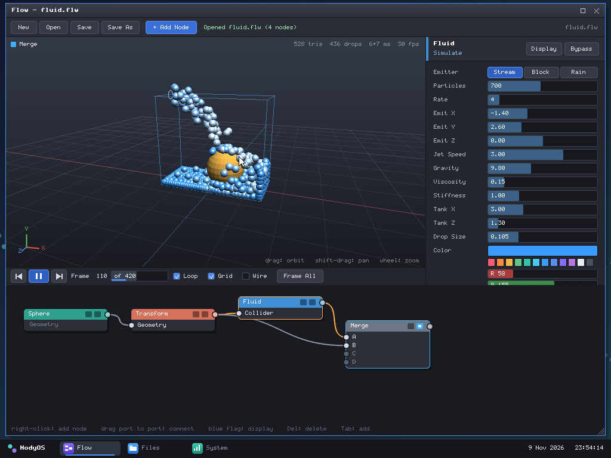
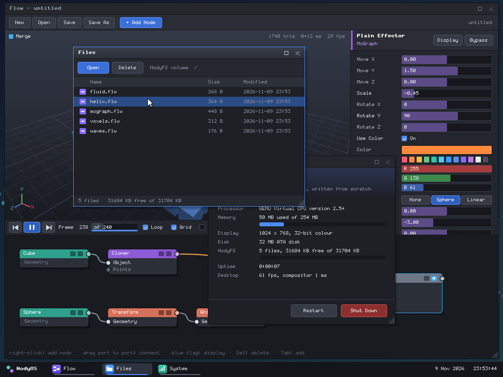
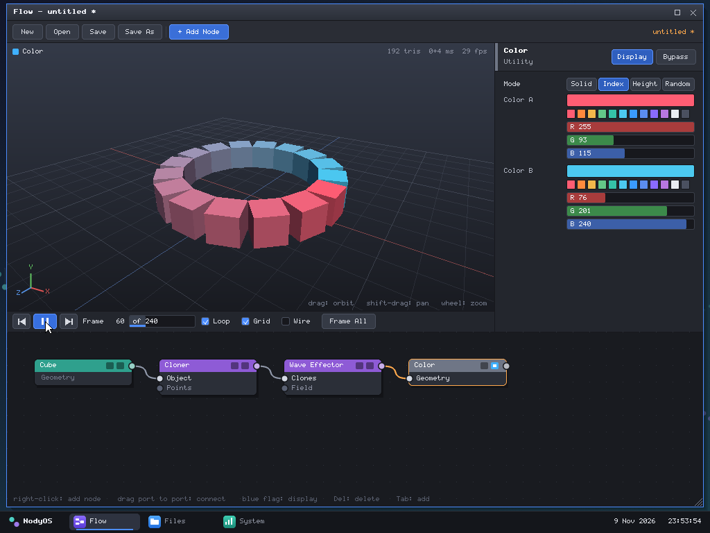

# NodyOS

A small x86 operating system written from scratch, and **Flow**, a node-based
3D VFX application that runs on it.

- its own two-stage boot loader (BIOS, real mode to 32-bit protected mode)
- a kernel with no libc and no third-party code: interrupts, timer, PS/2
  keyboard and mouse, ATA disk, real-time clock, heap
- a window manager: overlapping windows you can drag, focus, resize, maximise
  and close, a dock, a desktop
- **NodyFS**, its own on-disk filesystem
- **Flow**: connect nodes in a graph editor and watch the result render live
  in a software-rasterized 3D viewport. It has a MoGraph cloner with
  effectors, deformers, and a particle fluid solver, and it saves scenes to
  the disk in its own `.flw` format.

Everything in the image is in this repository: about 7,000 lines of C and
assembly, including the font. The kernel is a 150 KB flat binary.



## Run it

You need `nasm`, an `i686-elf` GCC and binutils, and QEMU
(`brew install nasm i686-elf-gcc qemu`).

```bash
make run
```

This builds `nody.img` and boots it in QEMU. The desktop comes up with Flow
open on an animated example.

- **Mouse**: the kernel turns on QEMU's absolute pointer, so the cursor follows
  your pointer without grabbing it. If that device is missing it falls back to
  a plain PS/2 mouse (click the window to grab, Ctrl+Alt+G to release).
- **Disk**: `nody.img` is created once. Later builds only rewrite the boot
  loader and the kernel, so files you saved survive a rebuild. `make newdisk`
  starts over with an empty volume.
- The serial port is connected to the terminal and logs what the system does.

## Using the desktop

Drag a window by its title bar, click a window to bring it to the front, drag
the bottom-right corner to resize, double-click the title bar (or the square
button) to maximise, and use the cross to close. The dock starts and switches
between the three applications:

| App | What it does |
| --- | --- |
| **Flow** | the node-based VFX application |
| **Files** | lists the NodyFS volume; double-click a scene to open it, delete files |
| **System** | CPU, memory, disk and frame-rate figures; **Restart** and **Shut Down** |



## Using Flow

The window has a 3D viewport, a parameter panel for the selected node, a
timeline, and the node graph along the bottom. Geometry flows left to right
through the wires.

1. **Add a node**: right-click in the graph (or press Tab, or use *+ Add Node*).
   A new node is wired after the selected one automatically.
2. **Connect**: drag from a node's output port (right edge) to an input port
   (left edge). Drag a wire's end off a port to disconnect it.
3. **Display**: the blue flag on a node chooses what the viewport shows. The
   yellow flag bypasses a node.
4. **Edit**: select a node and drag its sliders. Right-click a parameter to
   reset it. The viewport updates as you drag.
5. **Animate**: press Space or the play button. Fluid simulations restart
   from frame 0 (rewind).
6. **Save / Open**: Ctrl+S, Ctrl+O, or the toolbar.

| Viewport | |
| --- | --- |
| drag | orbit |
| Shift-drag, middle-drag | pan |
| wheel, right-drag | zoom |
| F / G / W | frame all / grid / wireframe |

| Graph | |
| --- | --- |
| drag a node | move it |
| drag the background | scroll |
| right-click a node | display, bypass, disconnect, duplicate, delete |
| Delete or Backspace | delete the selected node |
| D / B | display / bypass the selected node |

### Nodes

| Category | Nodes |
| --- | --- |
| Geometry | Cube, Sphere, Cylinder, Cone, Torus, Plane |
| MoGraph | **Cloner** (linear, radial, grid, or onto the points of another input), **Plain**, **Random**, **Wave** and **Step** effectors |
| Deform | Transform, Animate (spin, bob, orbit, pulse), Twist, Noise |
| Simulate | **Fluid** |
| Utility | Color (solid, by index, by height, random), Merge |

**Effectors** change the clones a Cloner produces (position, scale, rotation,
colour) before they become geometry. Each has a falloff (none, sphere, linear).
Plug any geometry into an effector's *Field* input and the falloff follows
that object, so an animated object can sweep an effect across the clones.

**Fluid** is a particle solver (position-based, in the smoothed-particle
family: density relaxation with a near-density term, viscosity, a uniform grid
for neighbour search). It emits a stream, a dropped block, or rain into a
tank, and collides with the bounding sphere or box of whatever is wired into
its *Collider* input. Its output is a set of points drawn as shaded spheres;
feed it to a Cloner's *Points* input to put any mesh on every particle.

Five example scenes are written to a fresh disk: `mograph`, `fluid`, `helix`,
`voxels` and `waves`.



## How it works

```
boot/boot.asm     stage 1 (MBR) loads stage 2; stage 2 enables A20, reads the
                  E820 memory map, loads the kernel to 1 MiB through an unreal-
                  mode copy, sets a VBE linear framebuffer (1024x768x32), enters
                  protected mode and jumps to the kernel
kernel/           entry and interrupt stubs (asm), IDT / PIC / PIT, heap,
                  serial, ATA PIO, RTC, PS/2 keyboard + mouse, main loop
lib/              memory and string routines, formatting, maths (sin, noise),
                  input queues, NodyFS
gui/              2D drawing, the hand-drawn font, window manager, widgets
flow/             engine: geometry, node types, fluid, scene files, software
                  renderer; and the application itself
apps/             Files and System
tools/            test and inspection tools that run on the host (not in the image)
```

The window manager gives every window its own pixel buffer and recomposites
only the damaged part of the screen each frame. The viewport is a z-buffered
scanline rasterizer (flat-shaded triangles, sphere impostors for particles,
depth-tested lines); its per-pixel loops are integer only.

### Disk layout

| Sectors | Contents |
| --- | --- |
| 0 | boot loader stage 1 |
| 1 - 15 | boot loader stage 2 |
| 16 - 2047 | kernel |
| 2048 - | NodyFS volume |

NodyFS is a flat volume: a superblock, a 64-entry directory, a block
allocation table with one entry per 4 KiB block, then data. A save writes the
new data blocks first, then the table, then the directory, and ends with an
ATA cache flush. The layout is described in `lib/fs.h`.

### The `.flw` scene format

Little-endian. A 56-byte header (`"FLOW"`, version, node count, display and
selected node, flags, loop length, camera, graph scroll, checksum), followed
by one record per node: a 12-byte type name, graph position, flags, then the
parameter values as 32-bit floats and one byte per input naming its source
node. Types are stored by name and parameters by count, so files keep loading
when node types gain parameters. A file with a bad checksum, an unknown node
type or a wiring loop is rejected and the open scene is left untouched. The
full layout is at the top of `flow/scene.c`.

`tools/nodyfs.py` reads the volume and decodes scenes from the host:

```bash
python3 tools/nodyfs.py
```

```bash
python3 tools/nodyfs.py scene fluid.flw
```

## Testing

`tools/vm.py` boots the image in a headless QEMU and drives it over QMP with
real mouse and keyboard events, taking screenshots:

```bash
python3 tools/vm.py start
```

```bash
python3 tools/vm.py do "click 285 46; wait 0.5; shot build/menu.png"
```

```bash
python3 tools/vm.py stop
```

`make host` builds `build/hostsim`, which runs the window manager, the
applications, the engine and NodyFS as a normal process under the address
and undefined-behaviour sanitizers. It can replay the same input scripts and
has three self-tests:

```bash
./build/hostsim "fstest; fuzz 5000 1; monkey 8000 1"
```

- `fstest`: multi-block files, overwrite, remount, directory limit, deletion
- `fuzz`: random graphs and parameters, each evaluated, rendered, and
  round-tripped through the `.flw` format (a corrupted copy must be rejected)
- `monkey`: random clicks, drags and keys all over the desktop

## Limits

- BIOS boot on a PC-compatible machine with a VBE linear framebuffer; tested
  in QEMU only.
- One CPU, no memory protection: the applications are part of the kernel
  image and share its address space.
- NodyFS has one directory, 64 files, and file names up to 31 characters.
- A scene holds up to 40 nodes; evaluation is capped at 120,000 triangles and
  the fluid at 1,400 particles.
